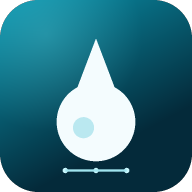

<p align="center">
  
</p>

<h1 align="center">WaterNet</h1>

<p align="center">
  <strong>Mobile-first water distribution modeling in the browser.</strong><br>
  Build a network, run a real hydraulic simulation, and inspect pressures, flows, and tank levels — online or offline.
</p>

<p align="center">
  Vanilla JavaScript · No build step · Installable PWA · Works on desktop and mobile
</p>

---

## Overview

WaterNet is a self-contained water distribution modeling app built around a real **Global Gradient Algorithm (GGA)** hydraulic solver. It is designed for phones and tablets first, but runs equally well in a desktop browser.

There is no backend, no framework, and no build step. The entire app is plain HTML, CSS, and JavaScript, and it can be hosted from any static file server. Install it from the browser to use it like a native app, including offline.

Typical uses:

- Sketch and edit a distribution network on a map
- Run steady-state or extended-period simulations
- Explore pressures, flows, velocities, headloss, and tank levels over time
- Import and export EPANET 2.x INP files
- Keep a portable WaterNet JSON copy of a project

## Features

### Network editing

- Interactive canvas map with pan, zoom, fit-to-network, and node dragging
- Junctions, reservoirs, cylindrical tanks, pipes, pumps, and TCV valves
- Property editors with validation and live result metrics
- Rename nodes and links; connected links update automatically
- Delete nodes or links with confirmation and undo support
- Undo/redo history and automatic local persistence
- Pressure, velocity, flow, and headloss map coloring
- Dark mode, optional map labels, and responsive layouts down to 320 px

### Hydraulic simulation

- Steady-state and extended-period simulation (EPS)
- Global Gradient Algorithm with Newton iterations
- Hazen–Williams headloss with minor losses
- Demand patterns and demand multipliers
- Pumps with quadratic head curves and speed settings
- TCV valves and open/closed link status
- Tank level tracking with min/max limits
- Disconnected-node, convergence, and operating-limit warnings

### Results and data

- KPI cards for minimum/maximum pressure, maximum velocity, and demand
- Time-series charts for node pressure, tank level, link flow, and velocity
- Timeline playback and scrubbing across simulation snapshots
- Critical-node and warning summaries
- Searchable node/link data view with keyboard-accessible rows

### Files and interoperability

- Import EPANET `.inp` models in SI or common US units
- Export EPANET-compatible `.inp` files in SI units
- Import and export WaterNet `.json` project files
- Bundled examples: **Riverside Park**, **Grid District**, **Booster Station**, and a blank network

### Installable PWA

- Web app manifest with regular and maskable icons
- Offline app-shell caching through a service worker
- Android/Chrome install support and standalone display
- Shortcuts for Map and Simulate views
- Deep-link views via `?view=map`, `?view=results`, `?view=data`, and `?view=more`

## Quick start

Serve the project directory with any static HTTP server:

```bash
cd WaterNet
python3 -m http.server 8080
```

Then open:

```text
http://localhost:8080/
```

If Python is not available, any equivalent static server works, for example:

```bash
npx serve .
```

> Service workers require a secure context. `localhost` is treated as secure, but a plain `http://` address on your LAN is not. For installation over a network, use HTTPS or deploy to a static host such as GitHub Pages.

### Install on Android

1. Open the app in Chrome.
2. Open the browser menu.
3. Choose **Add to Home screen** / **Install app**.
4. Launch WaterNet from the home screen.

## How to use

1. **Start a model** — open **More → Model library** and choose an example, or start from the blank canvas.
2. **Add a source** — place a reservoir or tank.
3. **Draw the network** — choose a tool, then click or tap the map. For pipes, pumps, and valves, tap the start node and then the end node.
4. **Edit properties** — tap any node or link to open its editor. Set elevations, demands, pipe sizes, pump curves, and tank limits.
5. **Run a simulation** — open **Simulate**, choose a duration and time step, then run.
6. **Inspect results** — scrub the timeline, play the simulation, switch map coloring, and use the charts to inspect individual assets.

A first-time blank canvas is intentional. Load a bundled example to see a complete network immediately.

## Supported model elements

| Element | Supported inputs |
| --- | --- |
| Junction | Elevation, base demand, demand pattern |
| Reservoir | Fixed total head, optional pattern |
| Tank | Elevation, initial/min/max level, cylindrical diameter |
| Pipe | Length, diameter, Hazen–Williams C, minor-loss coefficient, open/closed |
| Pump | Shutoff head, maximum flow, relative speed |
| Valve | TCV with diameter, loss setting, open/closed |

Internal units are SI:

- Length, elevation, and head: **m**
- Diameter: **mm**
- Flow: **L/s**
- Velocity: **m/s**
- Pressure: **m of head**

INP imports convert common US flow units (CFS, GPM, MGD, IMGD, AFD) and associated lengths, diameters, and heads into SI. Exported INP files use LPS.

## INP compatibility

WaterNet reads and writes the core hydraulic subset of EPANET 2.x:

- `[TITLE]`, `[JUNCTIONS]`, `[RESERVOIRS]`, `[TANKS]`
- `[PIPES]`, `[PUMPS]`, `[VALVES]`
- `[PATTERNS]`, `[CURVES]`, `[COORDINATES]`
- `[STATUS]`, `[TIMES]`, `[OPTIONS]`

Not modeled:

- PRV, PSV, and FCV valves
- Rule-based controls and simple controls
- Water quality and MSX
- Tank volume curves (cylindrical tanks only)
- Full EPANET report-file generation

## Keyboard shortcuts

| Key | Action |
| --- | --- |
| `S` | Select tool |
| `J` | Add junction |
| `L` | Add pipe |
| `P` | Add pump |
| `T` | Add tank |
| `R` | Add reservoir |
| `V` | Add valve |
| `F` | Fit network to view |
| `+` / `-` | Zoom in / out |
| `Ctrl/Cmd + Z` | Undo |
| `Ctrl/Cmd + Y` or `Ctrl/Cmd + Shift + Z` | Redo |
| `Esc` | Close the current panel |

## Project structure

```text
WaterNet/
├── index.html              App shell and SVG icon sprite
├── styles.css              Responsive light/dark UI
├── app.js                  Map, editors, charts, file handling, PWA wiring
├── solver.js               GGA hydraulic engine and EPS
├── inp.js                  EPANET INP parser, writer, and unit conversion
├── samples.js              Bundled example networks
├── manifest.webmanifest    PWA metadata, icons, and shortcuts
├── sw.js                   Offline app-shell cache
└── icons/                  App icons
```

## How the solver works

`solver.js` solves the coupled node-continuity and link-energy equations with the Global Gradient Algorithm:

- Unknowns are nodal heads and link flows.
- Hazen–Williams resistance uses `10.674 · L / (C^1.852 · D^4.871)` in SI units.
- Pumps are represented by a quadratic head curve derived from shutoff head and maximum flow, with check-valve behavior near zero flow.
- Each iteration assembles and solves the linearized system, then updates heads and flows.
- Convergence requires both continuity and energy residuals to fall within tolerance.
- For EPS, the hydraulic state is solved at each time step and tank levels are integrated from net inflow over the step.
- Disconnected nodes, non-convergence, tank-limit excursions, and pump shutoff conditions are reported as warnings.

## Notes for developers

- No dependencies, bundler, or transpilation are required.
- Loaded as global scripts (not ES modules) in this order: `solver.js`, `inp.js`, `samples.js`, then `app.js`.
- Project state is stored in `localStorage` under `waternet.project.v1`.
- Preferences (theme, labels) use `waternet.prefs.v1`.
- Relative paths and a relative manifest scope make the app suitable for GitHub Pages or any subdirectory deployment.
- After changing cached assets, update the `CACHE` name in `sw.js` to force clients to refresh.

## Validation

The implementation has been exercised with:

- Analytic two-pipe cases for the hydraulic solver
- All bundled sample networks
- INP export → import → simulation round-trips with matching results
- Blank-network creation, editing, simulation, undo/redo, and node dragging
- Touch placement, pinch zoom, and mobile interaction checks
- INP import through the UI and query-string view shortcuts
- Responsive checks at 320 px, 360 px, and 390 px widths
- PWA manifest validation, installability checks, and offline reloads

## Limitations

WaterNet is a focused hydraulic modeling tool, not a full EPANET replacement:

- Demand-driven analysis only; no pressure-dependent demand
- No advanced valve types, controls, or rule engines
- No water-quality or MSX simulation
- Cylindrical tanks only
- No GIS or CAD import/export
- Hydraulic results should be reviewed by a qualified professional before design or operational use

## Credits

The EPANET name and INP file format originate from the U.S. EPA and the Open Water Analytics EPANET project. WaterNet is an independent project and is not affiliated with or endorsed by the EPA or OWA.

## Disclaimer

WaterNet is intended for planning, education, and preliminary engineering. Always verify hydraulic results with an appropriately qualified engineer before using them for detailed design, construction, or operational decisions.
